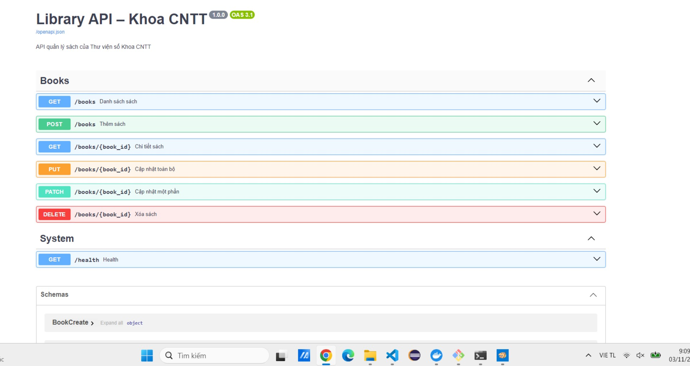
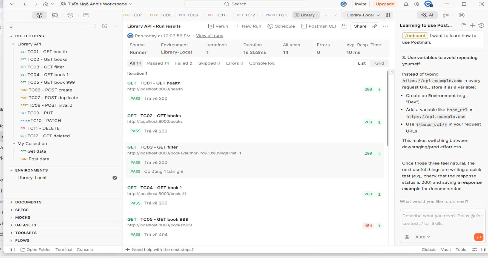

# Library API – Thư viện số Khoa CNTT

## Mô tả
API quản lý sách cho Thư viện Khoa CNTT, xây dựng bằng FastAPI. Thay thế việc quản lý sách bằng tệp Excel, cho phép website và ứng dụng di động cùng gọi vào lấy dữ liệu. Hỗ trợ xem danh sách (tìm kiếm, phân trang), xem chi tiết, thêm, sửa toàn bộ, sửa một phần và xóa sách. Dữ liệu lưu trong bộ nhớ, mất khi khởi động lại server.

## Cài đặt và chạy
```bash
git clone <link-repo>
cd library-api
python -m venv .venv
.venv\Scripts\activate        # Windows
# source .venv/bin/activate   # Linux/macOS
pip install -r requirements.txt
uvicorn app.main:app --reload
```
Mở tài liệu API tại http://127.0.0.1:8000/docs

## Bảng endpoint
| Phương thức | Endpoint | Chức năng | Thành công | Lỗi |
|---|---|---|---|---|
| GET | /books | Danh sách; lọc ?q=, ?author=; phân trang ?skip=, ?limit= | 200 | 422 |
| GET | /books/{id} | Chi tiết một cuốn sách | 200 | 404 |
| POST | /books | Thêm sách mới | 201 | 409, 422 |
| PUT | /books/{id} | Cập nhật toàn bộ | 200 | 404, 409, 422 |
| PATCH | /books/{id} | Cập nhật một phần | 200 | 404, 422 |
| DELETE | /books/{id} | Xóa sách | 204 | 404 |

## Cách chạy kiểm thử
1. Khởi động lại server (để dữ liệu về trạng thái ban đầu).
2. Import 2 file trong thư mục `postman/` vào Postman, chọn environment Library-Local.
3. Chuột phải collection Library API → Run collection → Run. Kết quả mong đợi: 14 test passed, 0 failed.

Hoặc chạy bằng Newman:
```bash
npx newman run postman/Library-API.postman_collection.json -e postman/Library-Local.postman_environment.json
```

## Ảnh minh chứng

